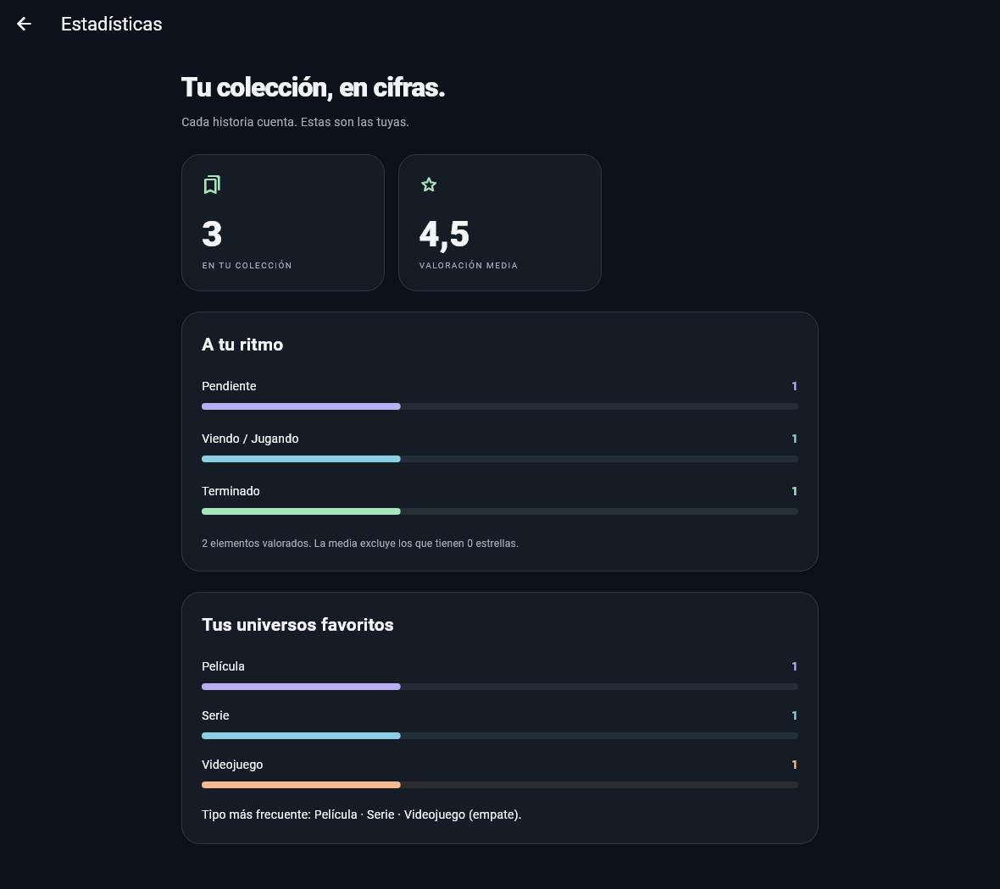

# Mi Watchlist

**Alejandro Galindo — Desarrollo de Interfaces**

Aplicación Flutter para gestionar películas, series y videojuegos: alta, edición, borrado con confirmación, búsqueda, filtros, valoración, notas, portadas por enlace y estadísticas. Los datos se guardan localmente con shared_preferences.

## Contenido de la entrega

| Requisito | Ubicación |
| --- | --- |
| Proyecto Flutter completo | lib/, test/, android/, web/ y archivos de configuración |
| Boceto de la fase 0 | docs/boceto.png — pendiente de incorporar |
| Bitácora de las fases 0–8 | [docs/bitacora_ia.md](docs/bitacora_ia.md) — faltan respuestas y reflexiones personales |
| README con capturas | Este archivo y docs/capturas/ |
| Versión web compilada | [distribucion/MiWatchlist_web.zip](distribucion/MiWatchlist_web.zip) |

## Ejecutar

Entorno utilizado: Flutter 3.50.0 / Dart 3.14.0. Desde la raíz del proyecto:

    flutter pub get
    flutter run -d chrome --web-port 7357

Puedes sustituir chrome por edge o usar un dispositivo Android configurado. Mantén el mismo navegador y puerto para recuperar los datos locales.

## Versión web entregada

Extrae distribucion/MiWatchlist_web.zip y sirve la carpeta extraída por HTTP, por ejemplo con Python:

    python -m http.server 7357

Abre http://localhost:7357. No abras index.html directamente como archivo.

## Verificar y compilar

    dart format --output=none --set-exit-if-changed lib test
    flutter analyze
    flutter test
    flutter build web

La compilación se genera en build/web. Después de cambiar código, actualiza también el ZIP de distribucion/.

## Dependencias y organización

El estado usa StatefulWidget y setState. El único paquete adicional es shared_preferences; flutter_test y flutter_lints son dependencias de desarrollo.

- lib/modelos/: modelo Elemento y enums.
- lib/servicios/: guardado y carga de JSON.
- lib/pantallas/: lista, formulario, detalle y estadísticas.
- lib/widgets/: componentes reutilizables.
- test/: pruebas del modelo, almacenamiento, formulario y flujos.

## Portadas

En Añadir o Editar, el campo «Enlace de imagen» está debajo de las estrellas. Acepta enlaces directos http/https. Si falla la descarga, se muestra el icono del tipo. Vaciar el campo elimina la portada.

## Capturas

Capturas con datos de muestra de la interfaz inicial, anteriores a la ampliación de portadas.

## Pendientes antes de entregar

Añadir el boceto personal, completar las respuestas y reflexiones de la bitácora y revisar los comentarios del código con palabras propias.
