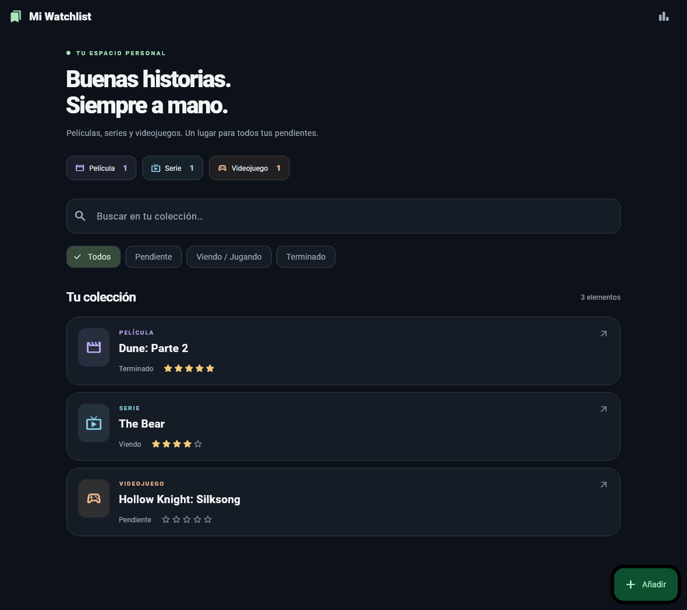
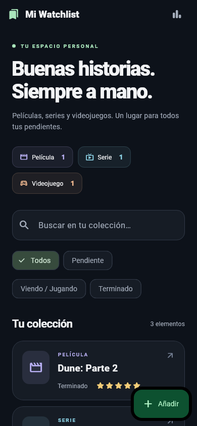
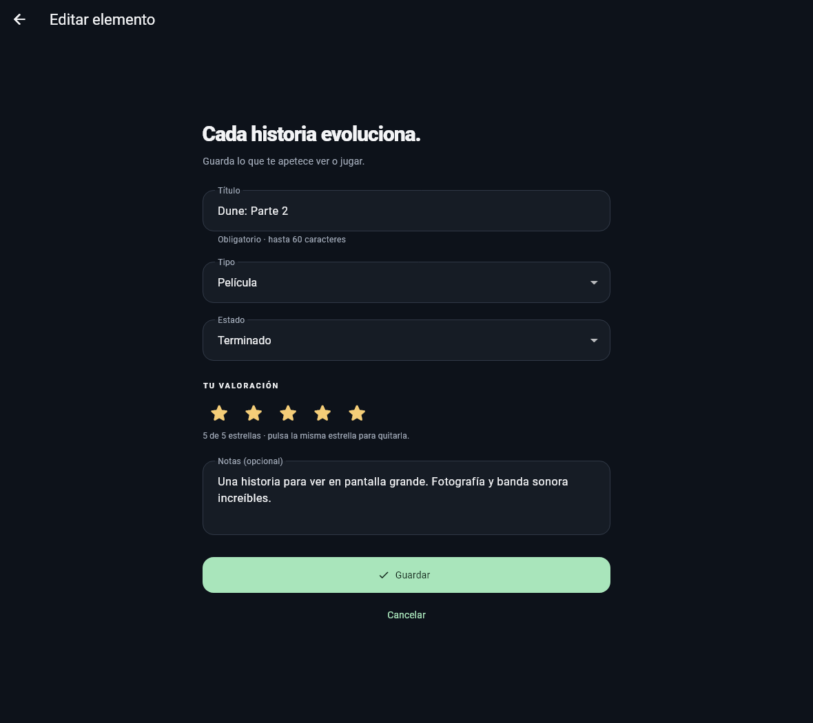
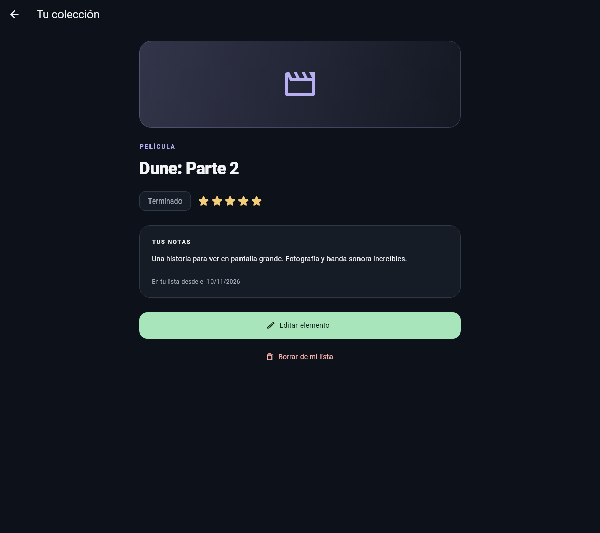

# Mi Watchlist

**Alejandro Galindo — Desarrollo de Interfaces**

App Flutter para organizar películas, series y videojuegos. Permite añadir, editar y borrar con confirmación, valorar con estrellas, buscar, filtrar y consultar estadísticas. Guarda la colección localmente en JSON con shared_preferences.

## Estructura de entrega

| Contenido | Ubicación | Estado |
| --- | --- | --- |
| Proyecto Flutter completo | lib/, test/, android/, web/, pubspec.yaml y pubspec.lock | Incluido |
| Boceto personal de la fase 0 | docs/boceto.png | Pendiente de añadir |
| Bitácora de IA, fases 0–8 | [docs/bitacora_ia.md](docs/bitacora_ia.md) | Fases estructuradas; reflexiones y respuestas personales pendientes |
| README con capturas | README.md y docs/capturas/ | Incluido |
| Versión web compilada | [distribucion/MiWatchlist_web.zip](distribucion/MiWatchlist_web.zip) | Incluida |

## Ejecutar el proyecto

Entorno utilizado: Flutter 3.50.0 y Dart 3.14.0. Instala Flutter, abre esta carpeta y ejecuta:

    flutter pub get
    flutter run -d chrome --web-port 7357

También puedes usar Edge o un dispositivo Android configurado. Ejecuta flutter pub get al cambiar de ordenador; las rutas locales no se versionan.

## Abrir la versión web entregada

Descarga y extrae distribucion/MiWatchlist_web.zip. Desde la carpeta extraída, con Python instalado:

    python -m http.server 7357

Abre http://localhost:7357. La web debe servirse por HTTP, no abrirse directamente como archivo. Los datos pertenecen al navegador y al origen; conserva el mismo puerto para mantener la colección.

## Comprobar y compilar

    dart format --output=none --set-exit-if-changed lib test
    flutter analyze
    flutter test
    flutter build web

La última compilación comprobada está incluida en el ZIP. Si modificas el código, recompila y actualiza el ZIP. Para Android puedes ejecutar flutter build apk --debug si tienes el SDK configurado.

## Organización y dependencias

lib/modelos contiene Elemento y sus enums; lib/servicios gestiona la persistencia; lib/pantallas contiene lista, formulario, detalle y estadísticas; lib/widgets incluye los componentes reutilizables. El estado usa StatefulWidget y setState. El único paquete adicional de la app es shared_preferences; flutter_test y flutter_lints son de desarrollo.

## Portadas de las reseñas

El formulario admite un enlace http/https directo a una imagen. Se guarda con el elemento y se muestra en la tarjeta y el detalle. Dejar el campo vacío al editar elimina la imagen. Si el servidor no permite cargarla o el enlace falla, aparece el icono del tipo. Las portadas remotas requieren conexión y dependen del servidor que las aloja.

## Capturas

Capturas de widgets reales con datos de muestra. La app empieza vacía.

## Pendientes personales

Añadir el boceto propio en docs/boceto.png y completar las respuestas y reflexiones de la bitácora. Revisar los comentarios técnicos generados con ayuda de IA y expresarlos con palabras propias. La bitácora recoge el trabajo real sin atribuir al alumno respuestas o aprendizajes no realizados.
